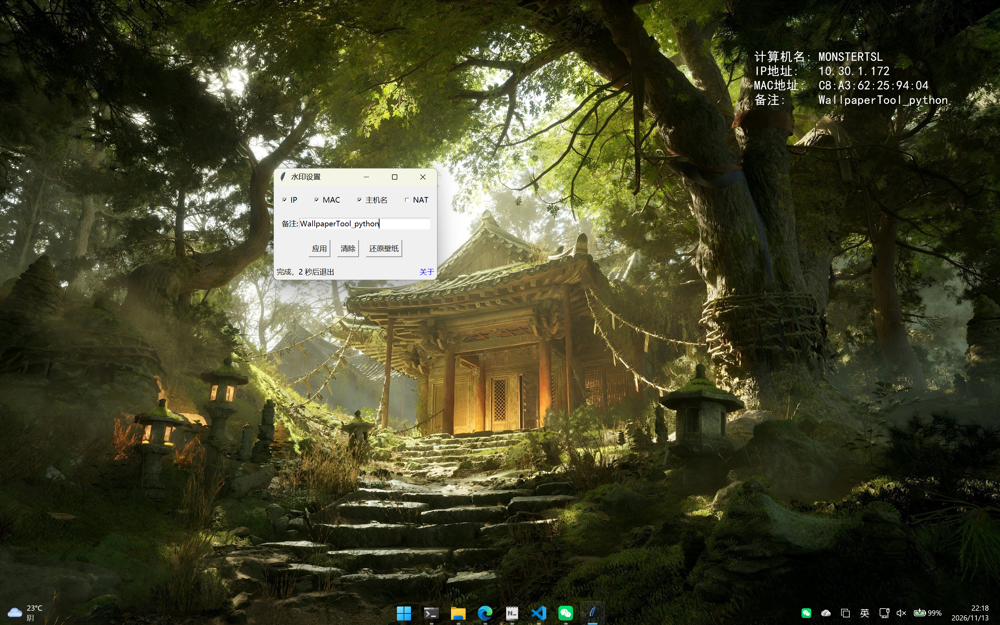
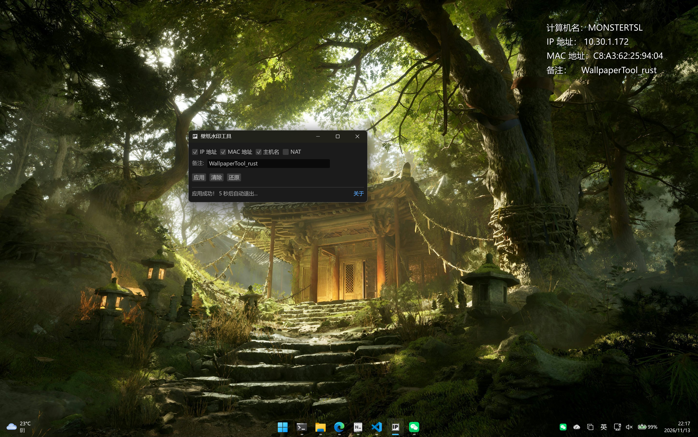

# WallpaperTool-桌面水印工具

> 一款轻量级 Windows (Python版兼容win7，Rust版不兼容win7) 桌面系统信息水印工具，可自动将主机名、IP 地址、MAC 地址等信息作为水印叠加到当前壁纸上，并支持一键还原。

一直有个在桌面添加水印的需求，找了网上一堆花里胡哨的软件，太多没必要的功能不够简洁轻量化，后面又发现微软官方出过一个软件 BgInfo 但是他不支持png格式的图片，所以写了这个小东西

## 功能特性

- **自动获取系统信息**：
  - 计算机名（Hostname）
  - 所有有效 IPv4地址（排除链路本地地址）
  - 物理网卡 MAC 地址（仅限 PCI/USB 设备，自动排除虚拟网卡）
- **NAT 地址显示（可选）**：
  - 勾选 NAT 后在弹窗中配置接口地址与接口字段
  - 接口返回 JSON 时填字段路径（支持 `a.b.c` 点路径）；返回纯文本 IP 则留空
  - 未勾选/获取失败时不显示，不影响正常生成
  - 接口可自行部署，可参考 [NetworkTools](https://github.com/monstertsl/NetworkTools)
- **双模式运行**：
  - **GUI 模式**：图形界面操作，直观易用。
  - **静默模式**：通过命令行参数 `-q` 或 `/q` 快速执行，适合脚本集成。
- **智能壁纸处理**：
  - 自动识别 Windows 7 / 10 / 11 的当前壁纸路径。
  - 按照 Windows “填充（Fill）” 模式缩放并居中，避免水印被裁剪。
- **自动备份与还原**：
  - 应用水印前自动备份原始壁纸为 `Wallpaper_Backup.jpg`（覆盖式，仅保留最新一份）。
  - GUI 中提供“还原壁纸”按钮，一键恢复。
- **高分辨率适配**：
  - 字体大小随屏幕高度动态调整。
  - 支持中文（默认使用 `msyh.ttc` 微软雅黑），兼容性好。
  - 自动缩放字体以防止文本溢出屏幕。

---

## 使用方式

### 1. 图形界面模式（默认）

直接双击运行程序，勾选需要显示的信息，点击【应用】即可。



## 使用Rust重构

使用Rust重构，更加现代化的GUI支持 深/浅主题 启动速度更快！！！运行速度更快！！！
建议优先使用Rust版，Rust版不兼容win7，如果老系统使用请使用Python版


### 2. 静默模式（命令行）

在 CMD 或 PowerShell 中运行：

```cmd
WallpaperTool -q
```

或

```cmd
WallpaperTool /q
```

> 注意：静默模式会使用全部信息（主机名 + IP + MAC），且无备注。

---

## 🔧 还原壁纸

如果后悔了，只需：
- 在 GUI 中点击【还原壁纸】按钮；或
- 手动将以下文件设为壁纸：
  ```
  %USERPROFILE%\WallpaperTool\Wallpaper_Backup.jpg
  ```

---


## 文件结构说明

程序运行后会在用户目录下创建：

```
%USERPROFILE%\WallpaperTool\
├── Wallpaper_Backup.jpg    ← 原始壁纸备份（覆盖更新）
├── Wallpaper_Watermark.jpg ← 带水印的新壁纸
└── config.json             ← 配置文件（NAT 接口设置等）
```

---

## 构建与打包

### Python 版

运行依赖：仅 Python 标准库（`tkinter`、`ctypes`、`urllib` 等），**无需 pip 安装任何第三方包**。

- Win7 环境：使用 Python 3.8（Win7 支持的最后一个大版本）
- Win10/11 环境：任意较新版本均可

打包为单文件 exe（需 `pip install pyinstaller`，UPX 可选）：

```cmd
pyinstaller -F -w -i ip.ico --upx-dir=. --clean ^
  --exclude-module sqlite3 --exclude-module unittest ^
  --exclude-module pydoc --exclude-module pydoc_data ^
  --exclude-module doctest --exclude-module multiprocessing ^
  --exclude-module concurrent --exclude-module lib2to3 ^
  --exclude-module distutils --exclude-module xmlrpc ^
  --exclude-module test --exclude-module tools ^
  main.py
```

产物：`dist\main.exe`（约 9.6 MB，UPX 对单文件模式几乎无收益，`--exclude-module` 才是关键）

> 注意：给 Win7 使用必须用 Python 3.8 打包；Python 3.9+ 打出的 exe 在 Win7 上无法运行。

### Rust 版

依赖 Rust 工具链（rustup），构建即可，产物零外部依赖：

```cmd
cd WallpaperTool_rust
cargo build --release
```

产物：`target\release\WallpaperTool.exe`（约 5 MB）

体积优化已写在 `Cargo.toml` 的 `[profile.release]` 中（`opt-level = "z"` + LTO + strip），无需额外参数。

> 注意：Rust 1.78+ 放弃了 Win7 支持，Rust 版仅适用于 Win10/11；Win7 请使用 Python 版。

---

## 注意事项

- 仅支持 **Windows**：Python 版兼容 Win7+，Rust 版需 Win10/11。
- 若系统未设置壁纸或使用锁屏幻灯片，可能无法读取 `TranscodedWallpaper`。
- 首次运行请确保有管理员权限（非必需，但部分系统策略可能限制壁纸修改）。
- 静默模式无错误提示，请通过日志或临时移除 `--windowed` 调试。

---

## 开源许可

本项目基于 [MIT License](./LICENSE) 开源，可自由使用、修改和分发。


